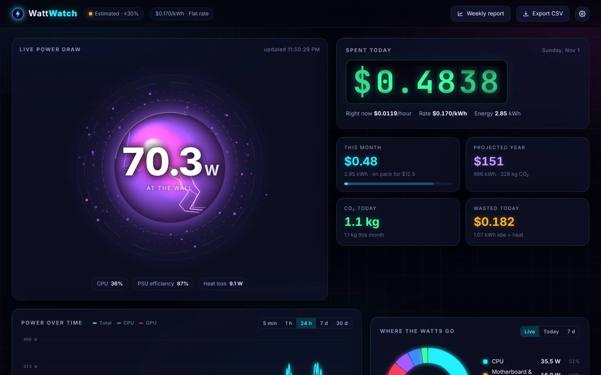
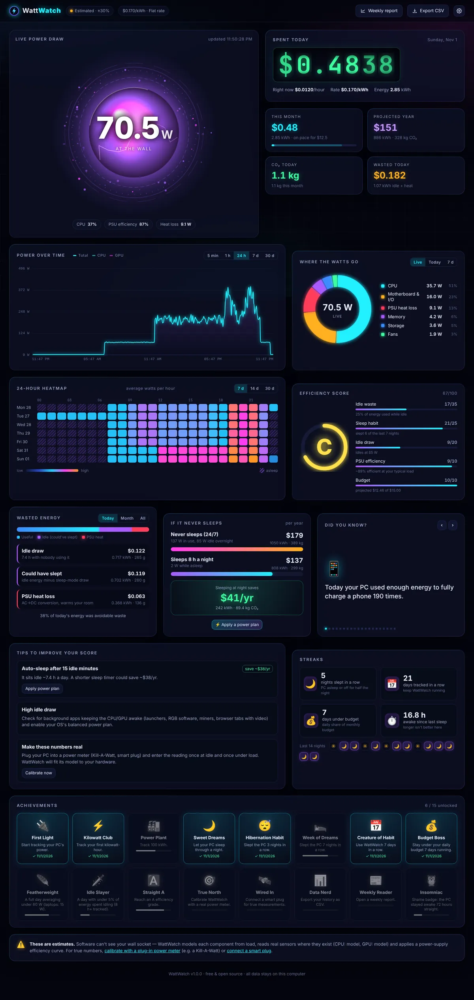
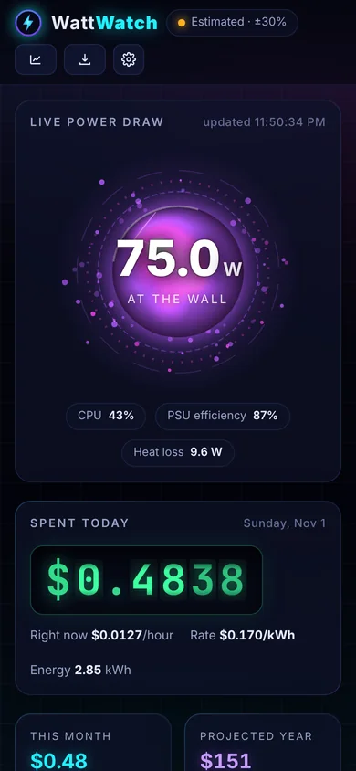

# ⚡ WattWatch

**See what your always-plugged-in computer really costs.** WattWatch is a free, open-source desktop app
that estimates how many watts your PC pulls from the wall, every second, and turns that into money,
wasted energy and CO₂, shown on a dark neon dashboard with a glowing power orb.

Windows · macOS · Linux · Python 3.10+ · no account, no cloud, no telemetry · MIT licensed



<details>
<summary>Full dashboard and phone layout</summary>



</details>

---

## What you get

| | |
|---|---|
| **Live power** | Wall watts updated every second, with a per-component breakdown: CPU, GPU, memory, storage, fans, motherboard, built-in display, battery charging, peripherals and **PSU heat loss**. |
| **Cost** | Money spent today (odometer), cost per hour right now, this month vs. your budget, projected year. Flat rate or **time-of-use** pricing. |
| **Wasted energy** | Idle draw, energy that could have been saved by sleeping, and PSU conversion loss — in kWh, money and CO₂. |
| **24/7 projection** | What the PC costs per year if it never sleeps vs. sleeping 8 h a night (TOU-aware). |
| **Visuals** | Pulsing power orb that changes colour with load, animated live line chart (5 min → 30 days), 24-hour heatmap, component donut. |
| **Fun stuff** | “Did you know” facts from your real numbers (phone charges, kettles, LED bulbs, EV miles, Big Macs, trees…), efficiency grade A–F with priced tips, 16 achievements and streaks. |
| **Nudges** | Budget alerts, idle detector with *Sleep now* and one-click *Apply power plan*, welcome-back summary of idle stretches. |
| **Reports** | Printable weekly report, CSV export per minute / hour / day. |
| **Honesty** | Every number is labelled *Estimated*, *Calibrated* or *Measured*. Calibrate with a Kill-A-Watt reading, or connect a Shelly / Tasmota / Kasa smart plug for true measurements. |
| **Tray icon** | A tiny orb that changes colour with wattage; live watts and today's cost in the menu. |

History is stored in SQLite (one row per minute), so totals survive restarts. Sleep and shutdown gaps are
detected and booked at your sleep / standby draw.

---

## Quick start

You need **Python 3.10 or newer** ([python.org](https://www.python.org/downloads/)).

### Windows (PowerShell)

```powershell
git clone https://github.com/pixelbuyte/wattwatch.git
cd wattwatch
py -m venv .venv
.venv\Scripts\activate
pip install -r requirements.txt
python -m wattwatch
```

### macOS

```bash
git clone https://github.com/pixelbuyte/wattwatch.git && cd wattwatch
python3 -m venv .venv && source .venv/bin/activate
pip install -r requirements.txt
python -m wattwatch
```

### Linux

```bash
git clone https://github.com/pixelbuyte/wattwatch.git && cd wattwatch
python3 -m venv .venv && source .venv/bin/activate
pip install -r requirements.txt
python -m wattwatch
```

On Linux the tray icon needs an AppIndicator/StatusNotifier extension on GNOME
(e.g. *AppIndicator and KStatusNotifierItem Support*). Without one, WattWatch still runs; use the browser.

The dashboard opens at **http://127.0.0.1:8787**. Running `python -m wattwatch` again while it's already
running just opens the dashboard.

> Prefer an installable command? `pip install .` inside the folder gives you a `wattwatch` command.

### Try it with sample data

```bash
python -m wattwatch --demo
```

Uses a throwaway database with three weeks of realistic history so every chart, streak and badge has
something to show. Your real data is untouched.

### Command-line options

| Option | What it does |
|---|---|
| `--port 8787` | Port for the local dashboard (also `WATTWATCH_PORT`) |
| `--no-tray` | Don't show a system-tray icon |
| `--no-browser` | Don't open the dashboard on start (handy for autostart) |
| `--data-dir PATH` | Where `wattwatch.db` lives (also `WATTWATCH_DATA_DIR`) |
| `--demo` | Throwaway database with sample history; notifications muted |
| `-v` | Verbose logging |

### Start with your computer

Settings → System → **Start WattWatch when I log in**. This writes a registry *Run* entry on Windows,
a LaunchAgent on macOS, or `~/.config/autostart/wattwatch.desktop` on Linux. WattWatch can only count
what it sees while running, so autostart keeps the totals honest.

---

## How the estimate works

Software cannot see your wall socket. WattWatch builds the number in five steps and always tells you
which kind of number you're looking at.

1. **Read real sensors where they exist**
   - CPU package power: Intel/AMD **RAPL** on Linux, **powermetrics** on macOS, **LibreHardwareMonitor** on Windows
   - GPU power: **NVIDIA NVML** (`pynvml`) on any OS, **amdgpu** hwmon on Linux, powermetrics on Apple Silicon
2. **Model everything else** from utilisation:
   - CPU (when no sensor): `P = P_idle + (TDP − P_idle) × (2u − u^1.4)` — the curve from Fan, Weber & Barroso,
     *Power Provisioning for a Warehouse-sized Computer* (2007). TDP comes from your exact CPU model via `py-cpuinfo`
     (override it in Settings).
   - Memory per GB, SSD/HDD idle + activity from disk throughput, fans from RPM sensors or load, a motherboard/I-O
     baseline, laptop display, battery charging, plus any peripherals you add.
3. **Add PSU losses** with an 80 PLUS efficiency curve (White → Titanium, or a laptop-brick curve). Below ~10 % load
   efficiency falls off a cliff, so an oversized PSU idling at 60 W can waste 15 W as heat.
4. **Calibrate** (optional): enter readings from a plug-in power meter. One reading scales the model; two or more
   (idle + busy) fit `wall = a × model + b`.
5. **Measure** (optional): with a smart plug connected, the wall number *is* the plug reading. Component estimates are
   scaled to match, and the model keeps calibrating itself from the plug so it stays accurate after you unplug it.

| Badge | Typical accuracy | When |
|---|---|---|
| 🟠 Estimated | ±30 % | out of the box |
| 🔵 Calibrated | ±10 % | after 1–2 meter readings |
| 🟢 Measured | ±1–2 % | metering smart plug connected |

**Laptops:** on battery WattWatch counts **0 W from the wall** (the energy is billed later, when you charge) but
still shows what the machine draws. While plugged in and charging it adds a charging estimate.

### Getting better sensor readings

<details>
<summary><b>Linux — let WattWatch read RAPL CPU energy counters</b></summary>

Since 2020 most distros make `/sys/class/powercap/*/energy_uj` root-only. Allow reading them once:

```bash
sudo chmod o+r /sys/class/powercap/intel-rapl:*/energy_uj   # until next reboot
```

To make it permanent, add a systemd-tmpfiles rule:

```bash
echo 'z /sys/class/powercap/intel-rapl:*/energy_uj 0444 root root -' | sudo tee /etc/tmpfiles.d/wattwatch-rapl.conf
sudo systemd-tmpfiles --create /etc/tmpfiles.d/wattwatch-rapl.conf
```

AMD Ryzen CPUs on recent kernels expose the same `intel-rapl` powercap interface.
</details>

<details>
<summary><b>macOS — real CPU/GPU watts via powermetrics</b></summary>

`powermetrics` needs root. Allow it without a password for your user only:

```bash
echo "$(whoami) ALL=(root) NOPASSWD: /usr/bin/powermetrics" | sudo tee /etc/sudoers.d/wattwatch
sudo chmod 440 /etc/sudoers.d/wattwatch
```

Restart WattWatch; Settings → Hardware shows `CPU: powermetrics`.
</details>

<details>
<summary><b>Windows — real CPU/GPU watts via LibreHardwareMonitor</b></summary>

1. Download and run [LibreHardwareMonitor](https://github.com/LibreHardwareMonitor/LibreHardwareMonitor).
2. *Options → Remote Web Server → Run* (default port 8085).
3. In WattWatch: Settings → Hardware → **LibreHardwareMonitor URL** = `http://localhost:8085/data.json`.

NVIDIA GPUs are read directly through NVML, no extra tools needed.
</details>

### Calibrating with a Kill-A-Watt (or any plug-in meter)

1. Plug the PC — and anything else on the same strip you want counted — into the meter.
2. Open Settings → **Calibrate**, wait ~10 s for the meter to settle, type its watts, **Save reading**.
3. Repeat once under heavy load (a game or stress test). Two spread-out points give a proper linear fit.

### Smart plugs (true measurements)

Settings → **Smart plug**, pick the type, enter the plug's IP address, **Test connection**, **Save**.
Everything is read directly over your LAN.

| Plug | Protocol used |
|---|---|
| Shelly Plus / Gen2 / Gen3 | `GET /rpc/Switch.GetStatus?id=N` → `apower` |
| Shelly Gen1 (Plug S, 1PM…) | `GET /status` → `meters[N].power` |
| Tasmota with energy monitoring | `GET /cm?cmnd=Status 8` → `StatusSNS.ENERGY.Power` |
| TP-Link Kasa HS110 / KP115 / HS300 | local XOR protocol on TCP 9999 (`emeter.get_realtime`) |
| Kasa on newer (KLAP) firmware | `pip install python-kasa` and enter your TP-Link credentials |

---

## Feature notes

- **Electricity price & time-of-use.** Settings → Money. Periods have a name, start/end time (may cross midnight)
  and days of the week; outside every period the flat price applies. Each minute is priced when it's recorded, so
  changing your price later doesn't rewrite history.
- **Budget alerts.** Set a monthly budget; you get one notification per month when the projected month goes over it,
  and one when actual spending does.
- **Idle detector.** Uses real keyboard/mouse idle time (Win32 `GetLastInputInfo`, macOS `HIDIdleTime`, X11
  XScreenSaver, GNOME Mutter, or `xprintidle`), falling back to sustained low CPU. After *N* idle minutes it notifies
  you and the dashboard offers **Sleep now** / **Apply power plan**.
- **Apply power plan** sets, for AC power only: display off after 10 min, sleep after 30 min.
  Windows: `powercfg`; macOS: `pmset -c` (asks for your password); Linux: GNOME `gsettings` or KDE `kwriteconfig`.
  It always asks before changing anything.
- **Efficiency score (A–F)** is out of 100: idle waste (35), sleep habit over the last 7 nights (25), idle draw (20),
  PSU efficiency at your typical load (10), budget (10).
- **Streaks.** A night counts as *slept* when the PC was asleep or off for at least half of the night window
  (default 23:00 + 8 h, configurable).
- **Facts** use rounded, commonly cited conversion constants (see `wattwatch/facts.py`). They're for intuition, not engineering.

## Privacy & data

- The server binds to **127.0.0.1 only**, rejects requests whose `Host` isn't localhost (DNS-rebinding guard) and
  requires a per-launch token header for anything that changes state (CSRF guard).
- History lives in a single SQLite file:
  - Windows: `%APPDATA%\WattWatch\wattwatch.db`
  - macOS: `~/Library/Application Support/WattWatch/wattwatch.db`
  - Linux: `~/.local/share/wattwatch/wattwatch.db`
- No analytics, no update checks, no external requests except to a smart plug or LibreHardwareMonitor you configure.

## Local API

Everything the dashboard shows is available as JSON on `http://127.0.0.1:8787`:

`/api/live` · `/ws` (1 Hz WebSocket) · `/api/history?range=1h|24h|7d|30d` · `/api/heatmap?days=7` ·
`/api/breakdown?range=today|7d` · `/api/daily` · `/api/summary` · `/api/facts` · `/api/achievements` ·
`/api/report/weekly` · `/report/weekly` (HTML) · `/api/export.csv?granularity=minute|hour|day&days=30` · `/api/system`

POST/DELETE endpoints (`/api/settings`, `/api/calibrate`, `/api/power/*`, …) require the `X-WattWatch-Token`
header that the dashboard page receives.

## Project layout

```
wattwatch/
  __main__.py        entry point, uvicorn + tray
  app.py             wires everything together
  collector.py       1 Hz sampler → per-minute SQLite rows, sleep/off detection
  analytics.py       series, heatmap, waste, projections, score, tips
  facts.py           "did you know" facts
  achievements.py    badges and unlock checks
  alerts.py          budget alerts, idle notifications
  reports.py         weekly report, CSV export
  power.py           sleep now / apply power plan
  autostart.py       start at login
  tray.py            system tray icon
  server.py          FastAPI routes, WebSocket, security middleware
  sensors/           hardware detection, RAPL/NVML/powermetrics/LHM readers,
                     PSU curves, idle detection, smart plugs, the power model
  static/            dashboard (vanilla JS + Canvas, no build step)
website/             project website (static, deployable to GitHub Pages)
tests/               pytest suite
```

## Development

```bash
pip install -r requirements.txt pytest httpx
python -m pytest
```

The dashboard is plain ES modules served by FastAPI, so edit `wattwatch/static/` and refresh.

## Website

`website/` is a static page (no build step). The included workflow `.github/workflows/pages.yml` publishes it to
GitHub Pages on every push to `main` that touches `website/`. Enable it once under
*Settings → Pages → Build and deployment → Source: GitHub Actions*.

## Limitations

- It's an estimate unless you calibrate or use a smart plug. Unusual hardware (multi-GPU rigs, servers, custom
  water-cooling pumps, RGB everything) needs a calibration reading or the *Peripherals* setting.
- Energy is only tracked while WattWatch runs. Gaps where the PC was on but WattWatch wasn't are left out rather than guessed.
- Windows CPU power without LibreHardwareMonitor is modelled.

## License

MIT — see [LICENSE](LICENSE).
